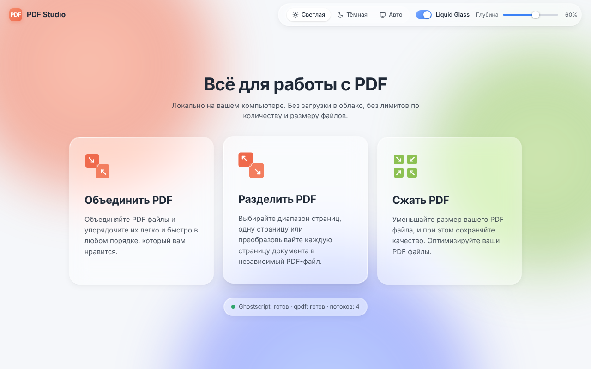
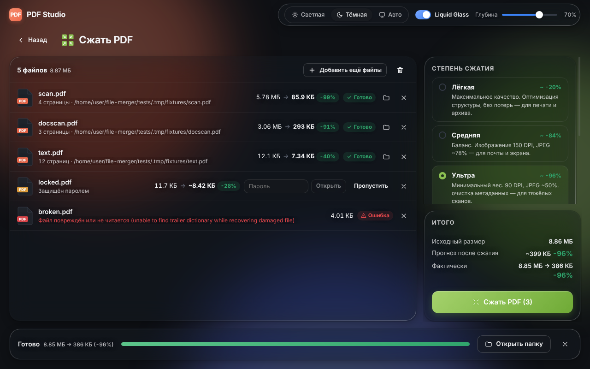

# PDF Studio

Десктопное приложение (Windows / macOS / Linux) для **локальной** работы с PDF:
объединение, разделение и пакетное сжатие. Файлы никуда не загружаются, нет
ограничений на число файлов (1 … 10 000+) и их размер (гигабайтные документы).



| Объединить PDF | Разделить PDF | Сжать PDF |
| --- | --- | --- |
| Порядок перетаскиванием строк или ↑ ↓, сортировка А→Я, имя итогового файла, прогресс | Все страницы → `page_001.pdf…`, диапазоны `1-5, 8, 12-20` (отдельно или одним файлом), визуальный выбор по миниатюрам | Пресеты «Лёгкая / Средняя / Ультра», прогноз веса «до → после» до запуска, фактический результат после |

## Установка на Windows

Скачайте **`PDF-Studio-Setup-1.0.0.exe`** и запустите его. Мастер установки на русском языке:
выбор папки, ярлык на рабочем столе и в меню «Пуск». Права администратора не нужны,
Ghostscript и qpdf уже внутри — дополнительно ничего ставить не требуется.

Без установки можно запустить **`PDF-Studio-Portable-1.0.0.exe`** (например, с флешки).

> Установщик не подписан цифровой подписью, поэтому Windows SmartScreen при первом запуске может
> показать «Windows защитила ваш компьютер». Нажмите **«Подробнее» → «Выполнить в любом случае»**.

### Установка через консоль (PowerShell)

Скачать последний релиз с GitHub и установить без вопросов (в профиль пользователя, права администратора не нужны):

```powershell
$url = "https://github.com/AlibekS/file-merger/releases/latest/download/PDF-Studio-Setup-1.0.0.exe"
$exe = "$env:TEMP\PDF-Studio-Setup.exe"
Invoke-WebRequest $url -OutFile $exe
Unblock-File $exe
Start-Process $exe -ArgumentList "/S" -Wait
```

Если установщик уже скачан — из папки с ним:

```powershell
.\PDF-Studio-Setup-1.0.0.exe /S
```

В другую папку: `/S /D=C:\Programs\PDF Studio` (ключ `/D=` — последним, путь без кавычек).
Для всех пользователей компьютера (из PowerShell от имени администратора): `/S /allusers`.

Программа ставится в `%LOCALAPPDATA%\Programs\pdf-studio`, запуск из консоли:

```powershell
& "$env:LOCALAPPDATA\Programs\pdf-studio\PDF Studio.exe"
```

Удаление без вопросов:

```powershell
& "$env:LOCALAPPDATA\Programs\pdf-studio\Uninstall PDF Studio.exe" /S
```

Готовые .exe собираются автоматически в GitHub Actions (workflow «Windows installer»: вкладка
Actions → Run workflow, файлы — в Artifacts; при push тега `v*` они публикуются в Releases).

## Возможности

- **Выбор файлов** — системный диалог с множественным выбором (рамка мышью, `Ctrl/Cmd+A`, `Shift+клик`)
  и Drag-and-Drop на всё окно; папки обходятся рекурсивно. «Добавить ещё файлы» доступно всегда.
- **Куда сохранить** — в выбранную папку или в исходную с суффиксами `_compressed`, `_merged`, `_split`.
  Существующие файлы никогда не перезаписываются (`имя (2).pdf`), запись идёт во временный файл с атомарным переименованием.
- **Прогноз сжатия** — мгновенная оценка по структуре PDF (потоковый сканер читает только словари объектов,
  данные изображений пропускаются → 1,4 ГБ анализируются за ~1–2 с), затем в фоне уточняется пробным сжатием
  1–2 страниц каждым пресетом (точность в тестах — в пределах нескольких процентов).
- **Пул фоновых обработчиков** по числу ядер CPU, общий прогресс «Обработано N из M», кнопка «Отменить»
  (процессы останавливаются, недописанные файлы удаляются).
- **Ошибки не останавливают очередь**: файлы с паролем помечаются, пароль вводится прямо в строке
  (или «Пропустить»); повреждённые — статус ошибки с причиной; если сжатый файл не меньше исходного —
  сохраняется копия оригинала с пометкой «уже оптимален, экономия 0%».
- **Внешний вид**: светлая / тёмная / авто (как в ОС) тема, переключатель **Liquid Glass**
  (Acrylic в Windows 11, vibrancy в macOS, на остальных системах — встроенная анимированная подложка),
  слайдер глубины прозрачности 0–100% (альфа панелей 0.85 → 0.25, размытие 8 → 32 px, с адаптивным контрастом текста).



## Движки обработки

| Операция | Основной движок | Резерв без внешних программ |
| --- | --- | --- |
| Сжатие «Средняя», «Ультра» | Ghostscript (ресэмплинг 150 / 90 DPI, JPEG ~78% / ~50%, CCITT для ч/б) + qpdf (object streams) | — |
| Сжатие «Лёгкая» | Ghostscript без потерь + qpdf | pdf-lib (пересохранение с object streams) |
| Объединение, разделение | qpdf (потоково, мгновенно, без перекодирования) | pdf-lib в фоновом потоке |
| Пароли | qpdf / Ghostscript | — |

Приложение ищет движки так: переменные `PDFSTUDIO_GS` / `PDFSTUDIO_QPDF` → встроенные в сборку
(`resources/bin`, см. [resources/bin/README.md](resources/bin/README.md)) → стандартные пути установки → `PATH`.
Статус движков показан на главном экране.

Установка движков, если они не встроены в сборку:

- **Windows**: [Ghostscript](https://ghostscript.com/releases/gsdnld.html) (64-bit) и
  [qpdf](https://github.com/qpdf/qpdf/releases) (zip или установщик).
- **macOS**:
  ```bash
  brew install ghostscript qpdf
  ```
- **Linux (Debian/Ubuntu)**:
  ```bash
  sudo apt install ghostscript qpdf
  ```

## Разработка

Требуется Node.js ≥ 22.18.

```bash
npm install
```

```bash
npm run dev
```

Сборка установщиков (`release/`). Для Windows сначала скачайте встроенные движки (нужен 7-Zip),
затем соберите (на Linux/macOS для этого нужен Wine, включая 32-битную часть):

```bash
npm run fetch:win-engines
```

```bash
npm run dist:win
```

```bash
npm run dist:mac
```

## Тесты

Сквозные тесты запускают собранное приложение (Playwright + Electron) и проверяют все операции
через настоящий IPC; нужны Python 3 с `Pillow` и `reportlab` для генерации тестовых PDF, а также gs и qpdf.

```bash
npm test
```

На Linux без дисплея: `xvfb-run -a npm test`. Нагрузочный прогон (150 файлов ≈ 870 МБ и PDF на 1,4 ГБ) — `tests/stress.mjs`.

## Структура

```
src/main/        main-процесс: окно и Liquid Glass, IPC, менеджер заданий, движки
  scanner.ts     потоковый сканер PDF (изображения, страницы, шифрование)
  engine.ts      Ghostscript / qpdf / pdf-lib: анализ, сжатие, объединение, разделение
  jobs.ts        пул обработчиков, прогресс, отмена, имена выходных файлов
src/preload/     безопасный мост window.pdf
src/renderer/    интерфейс на React
src/shared/      типы, прогноз размера, разбор диапазонов страниц
tests/           e2e, юнит-тесты, генератор тестовых PDF, нагрузочный прогон
```
